# Brzi početak – sa slikama

Sve se radi dugmadima na kartici **VANJSKO UREĐENJE PRO** u AutoCAD-u. Ništa ne treba kucati: svaka naredba otvara
prozor, a tačke i linije birate klikom u crtežu. Prozori pamte zadnje unose (dugme **Zadane vrijednosti** ih vraća).

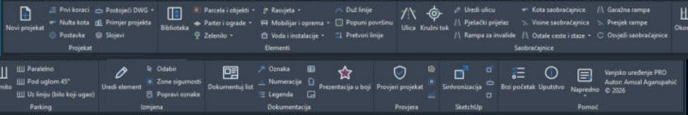

## 1. Probajte na primjeru (2 minute)

U praznom crtežu: **Projekat → Primjer projekta**, izaberite **Primjeri alata** i **U redu**.

Nacrta se ulica s raskrsnicom i pješačkim prijelazom, kružni tok s tri kraka, garažna rampa, parking (okomito,
paralelno, 45°) i drvored:

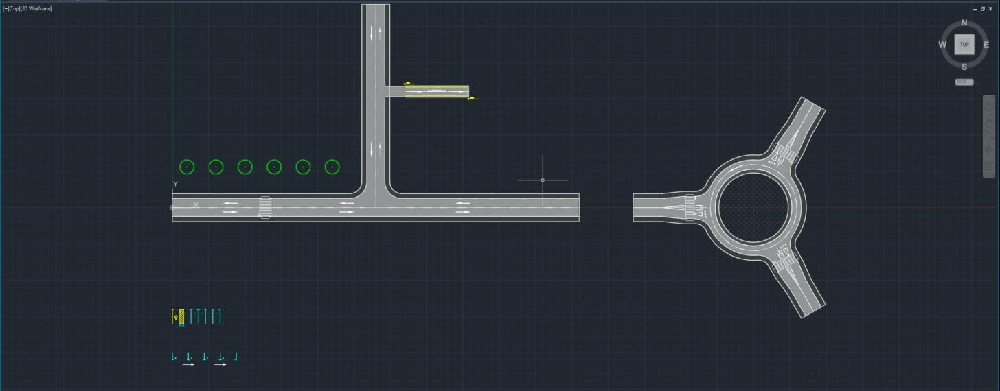

## 2. Mijenjanje: desni klik

Kliknite element, pa desni klik: **Uredi element…** (svi podaci u jednom prozoru), **Uredi ulicu…** (za ulicu) ili
**Oznaka**.

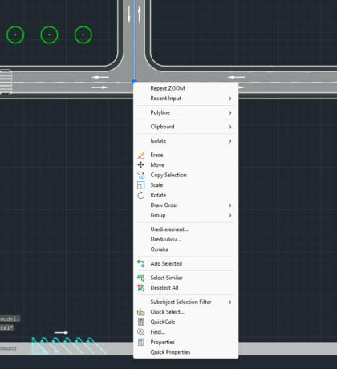

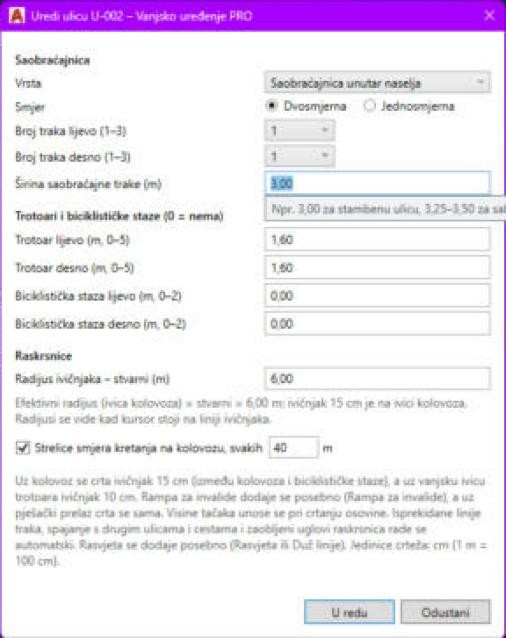

Ulice se same spajaju i ponovo crtaju poslije svake izmjene.

## 3. Projekat i visine

* **Projekat → Novi projekat**: naziv, jedinica crteža, mjerilo.
* **Projekat → Nulta kota**: apsolutna visina ±0,00, parter i saobraćajnice u odnosu na nju. Prozor kaže šta još
  nedostaje.

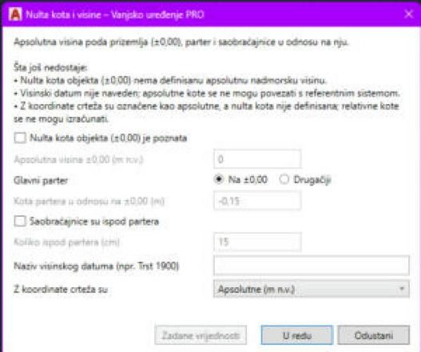

* Koordinate geodete (**Pomoć → Napredno → Kontrolne tačke**): **Dodaj tačku** (klik u crtežu + koordinate),
  zatim **Izračunaj** i **Primijeni**.

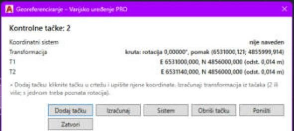

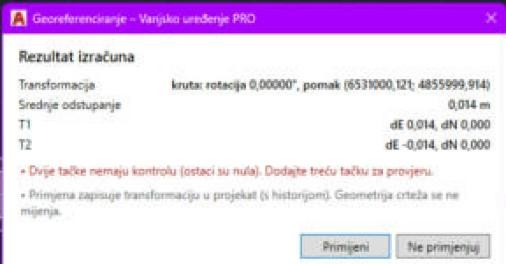

## 4. Saobraćajnice i parking

* **Ulica**: prvi prozor je presjek, drugi visine; zatim klikate tačke osovine.
* **Kružni tok**: jedan prozor, pa klik na centar.
* **Garažna rampa**: vrsta i presjek, crtanje, pa visine. Ispod tehničkog minimuma prozor odmah kaže šta ne valja
  i ne pušta dalje:

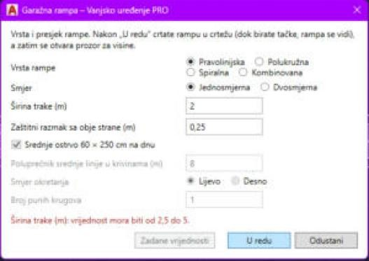

* **Parking → Okomito / Paralelno / Pod uglom 45°**: broj mjesta i mjesta za osobe s invaliditetom, pa tri klika
  (početak, smjer, strana prolaza). Brojevi se nastavljaju ili kreću od 1.

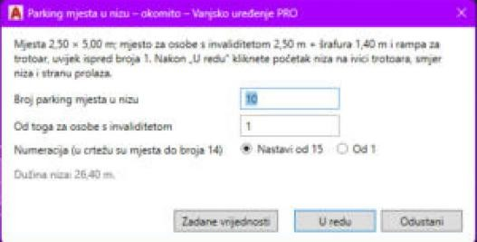

## 5. Zelenilo, oprema, provjera, list

* **Elementi → Biblioteka** ili padajući meniji (Zelenilo, Rasvjeta, Mobilijar); niz elemenata: **Duž linije**.
* **Provjera → Provjeri projekat**: kolizije, izlazak iz parcele, tehnički minimumi (rezultat u paleti *Provjera*).
* **Dokumentacija → Dokumentuj list**: brojevi, oznake, legenda, tabele, sjever, razmjernik i okvir odjednom.
* Količine, tabele, teren, pokazatelji: rezultat se otvara u prozoru.

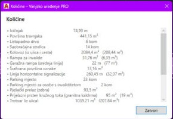

## 6. AutoCAD → SketchUp

U AutoCAD-u **SketchUp → Sinhronizacija → Pošalji u SketchUp** i sačuvajte paket (.sdpkg).

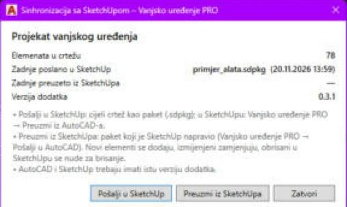

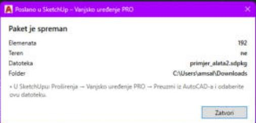

U SketchUpu **Proširenja → Vanjsko uređenje PRO → Sinhronizacija s AutoCAD-om → Preuzmi iz AutoCAD-a**:

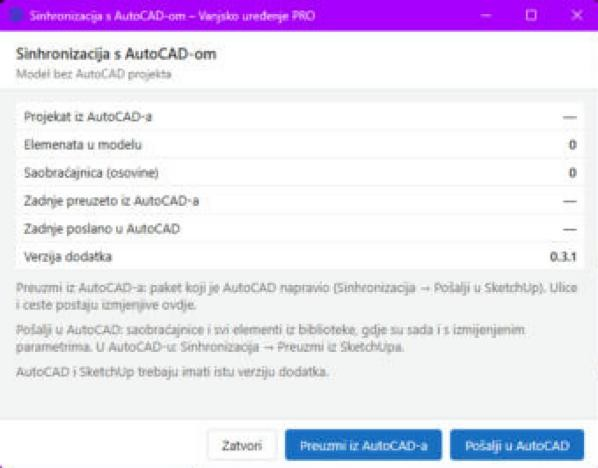

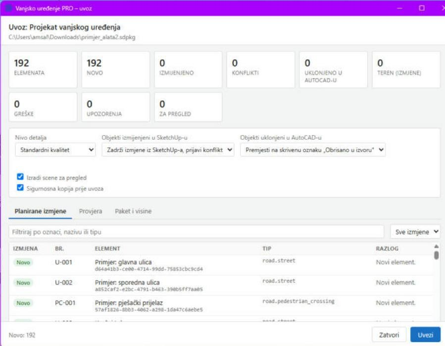

Ulice i ceste postaju izmjenjive u SketchUpu (Saobraćajnice → Uredi ulicu), a sve ostalo je u slojevima i scenama:

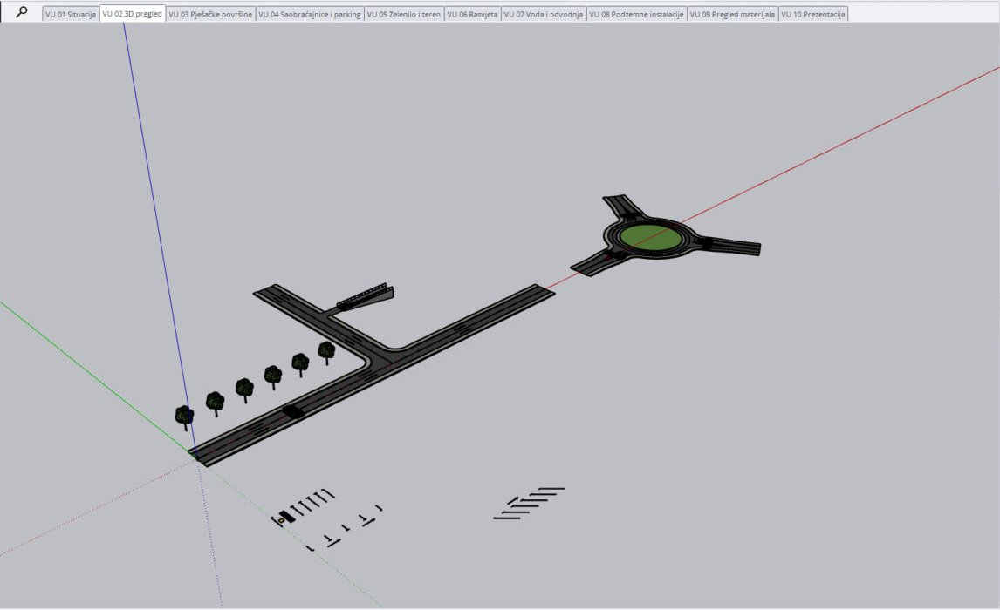

## 7. SketchUp → AutoCAD

Izmijenite u SketchUpu (npr. **Saobraćajnice → Uredi ulicu**), pa **Pošalji u AutoCAD**:

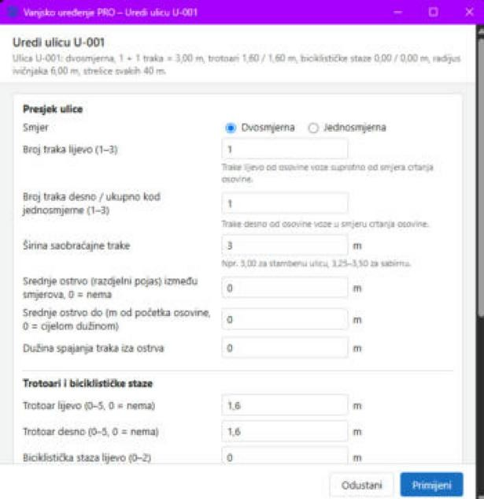

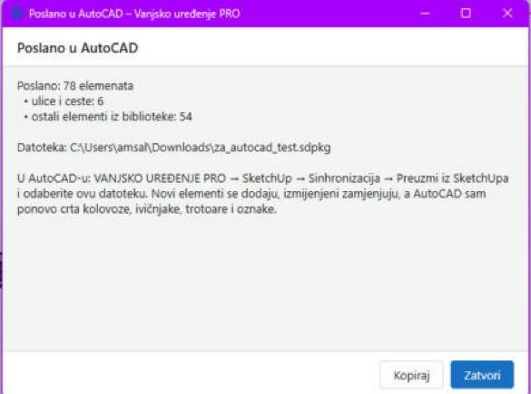

U AutoCAD-u **SketchUp → Sinhronizacija → Preuzmi iz SketchUpa** i izaberite datoteku. Izmijenjeni elementi se
zamjenjuju, novi dodaju, a brisanje se nudi samo za ono što je obrisano u SketchUpu:

## Kad nešto zapne

* AutoCAD i SketchUp trebaju imati istu verziju dodatka (vidi se u prozoru Sinhronizacija).
* Pitanja u komandnoj liniji umjesto prozora: **Pomoć → Napredno → Pitanja u prozorima / komandnoj liniji**.
* Cijelo uputstvo: **Pomoć → Uputstvo**.
* Uklanjanje oba dodatka: **DEINSTALIRAJ_SVE.bat** iz instalacionog zipa (crteži i modeli ostaju netaknuti).
